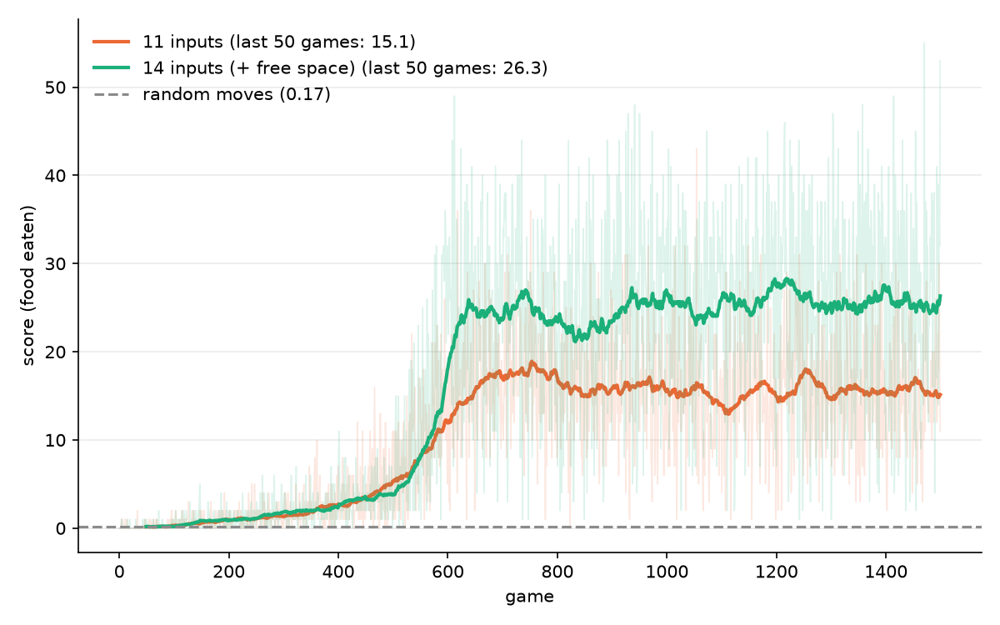
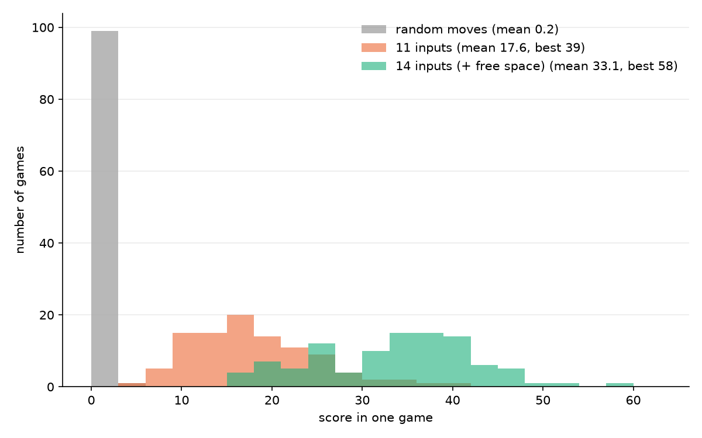

# Snake with a neural network from scratch

A Snake agent that learns to play on a 10x10 board with Q-learning. The neural network is written in NumPy only: forward pass, backpropagation and the Adam optimizer are all done by hand, no PyTorch.


*One game of the 14-input agent (score 30, seed 3). Not the average, see the results below.*

## How it works

The agent doesn't see the screen. At every step it gets a few numbers: is there a wall or part of its body straight ahead / to the right / to the left, which direction it is moving, and where the food is relative to its head (11 numbers). The network turns these into one score (a Q-value) for each of 3 moves: straight, turn right, turn left, and the agent plays the move with the best score.

It learns from rewards: +10 for eating, -10 for dying (or for going 100 steps without eating), 0 otherwise. The network is trained so that its score for a move matches `reward + 0.9 * best score of the next state`. To keep training stable I use a replay buffer (it learns from random old moves, not only the last one) and a slower copy of the network for the targets. In the beginning the agent plays random moves with probability epsilon, which goes from 1 to 0.01 over the first 600 games.

I checked the backpropagation against numerical gradients (`python src/nn.py`): the difference is about 8e-8.

## Results

Test: 100 games with no random moves.

| agent | mean score | best game |
|---|---|---|
| random moves | 0.2 | 3 |
| 11 inputs | 17.6 | 39 |
| 14 inputs (+ free space) | 33.1 | 58 |





During the first ~500 games epsilon is still high and the scores stay close to zero. After epsilon reaches its minimum (game 600) the score jumps, and the 11-input agent then stays at around 15 to 18 and doesn't improve.

My explanation: with 11 inputs the snake only knows what is right next to its head, not how much room it has left, so as it gets longer it often closes itself into a dead end. For the second version I added 3 inputs: for each of the 3 moves, how many cells can still be reached after it (a flood fill, divided by the number of cells on the board). The mean test score went from 17.6 to 33.1. I haven't tested other explanations, so this is an interpretation, not a proof.

Limits: it is still far from filling the board (the maximum score is 97), and every number comes from a single training run with seed 0, so I can't say how much they change with other seeds.

## How to run

1. `pip install -r requirements.txt`
2. `python src/nn.py` checks the backprop
3. `python src/train.py --tag basic` (11 inputs, about 1 minutes)
4. `python src/train.py --features space --tag space` (14 inputs, about 3 to 4 minutes)
5. `python src/plots.py` draws the charts, `python src/play.py --seed 3` saves a GIF of one game

Everything it produces goes to `results/`, including the trained weights (`*_net.npz`).

## Files

```
src/snake.py    the game and the inputs the agent gets
src/nn.py       neural network with hand-written backprop and Adam, plus the gradient check
src/agent.py    Q-learning agent (replay buffer, target network)
src/train.py    training loop, random baseline, final test
src/plots.py    score charts
src/play.py     plays one game and saves a GIF
results/        logs, scores, trained weights, plots
```